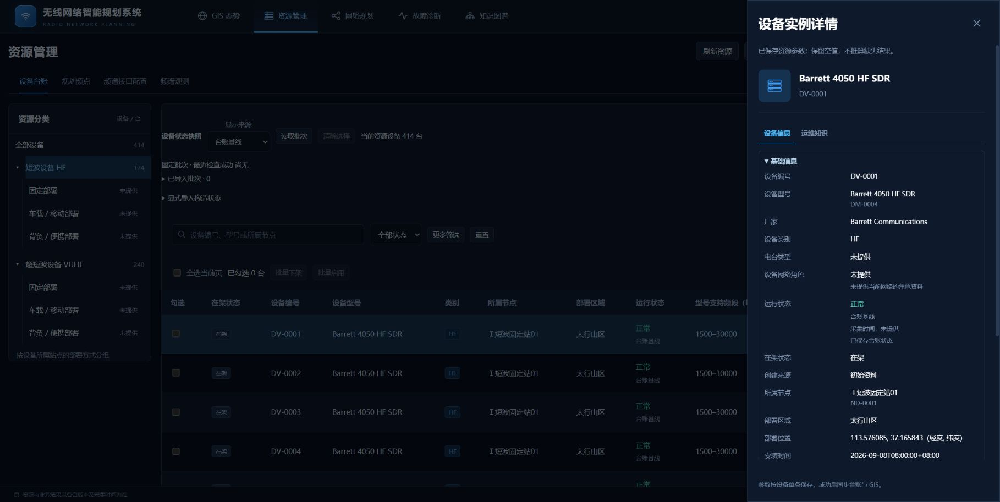
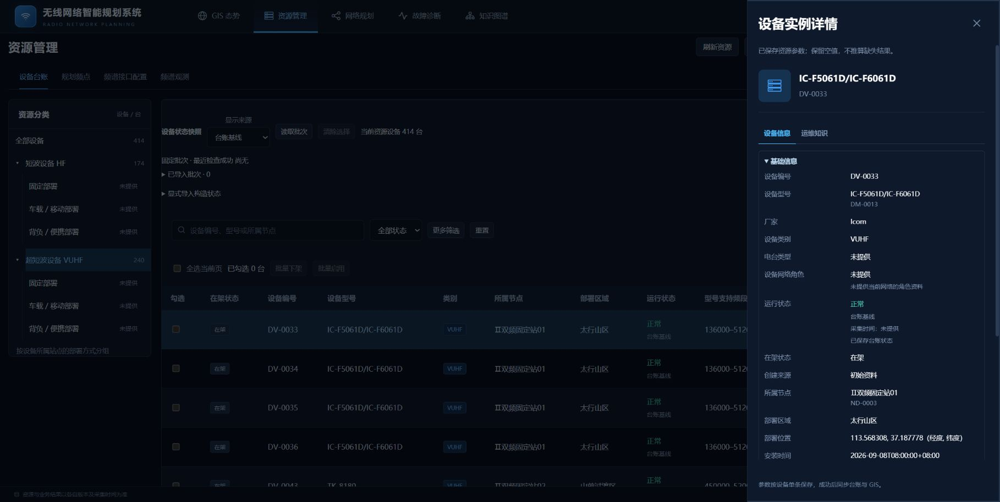

# 设备详情面板实测记录

日期：2026-11-02，Asia/Shanghai。测试对象为`GN-01-007`，使用Windows便携实例`deb1838`及真实Edge界面，资源版本为`resource-a2736f3fe68c66b4`。

从“资源管理→设备台账”分别选择短波、超短波设备，点击“查看详情”，查看设备基础信息、参数及运维知识。样例为HF设备`DV-0001`（`DM-0004`）和VUHF设备`DV-0033`（`DM-0013`），知识发布快照均为`KGV-1`。

实际结果：

1. 短波、超短波设备详情面板可正常打开。
2. 设备基本信息、参数及运维知识可查看，与所选设备一致。

本项结论为“通过”。本次按补充版用例的功能存在性和基本查看口径执行，使用构造联调资源；其他测试用例没有在本轮重跑或改判。

- [补充版测试文档](../output/测试用例_补充设备详情面板_20261102.docx)
- [结构化结果与截图摘要](evidence/device-detail-20261102/results.json)

以下截图为实测界面证据：

